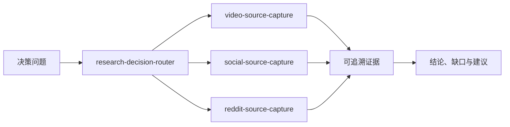

# Information Decision Workbench｜信息决策中台

一组面向 Codex 与通用 Agent 的信息采集 Skills。它从“这次信息要支持什么决定”出发，为不同来源选择合适路线，保留可复核证据，再交付结论。

> Decision-first source capture skills for Bilibili, YouTube, X, Xiaohongshu and Reddit.

## 它解决什么问题

很多信息任务卡在采集阶段：视频没有字幕、帖子藏在图片里、网页依赖登录态、不同网站需要不同工具，最后得到的总结又回不到原始来源。

这个项目把这些重复工作整理成四个可发现、可执行的 Skill：

| Skill | 适用场景 | 主要交付 |
| --- | --- | --- |
| `research-decision-router` | 多源调研、工具选择、受访问限制的信息任务 | 决策结论、证据、缺口和后续采集建议 |
| `video-source-capture` | B 站、YouTube 视频、字幕、音频和逐字稿 | 元数据、字幕或 ASR、必要的媒体文件 |
| `social-source-capture` | X、小红书帖子、图片、视频和 OCR | 正文、原始媒体、OCR、来源记录 |
| `reddit-source-capture` | Reddit 市场调研、用户研究和技术讨论 | 搜索结果、帖子、评论和采集清单 |



## 能进入哪些场景

- 看完一批 B 站或 YouTube 视频，形成带时间码的主题研究。
- 收集 X、小红书的正文和图片信息，把图片文字转成可搜索文本。
- 从 Reddit 提炼用户问题、具体经验、反对意见和反例。
- 面对多个来源时，先确定哪些证据真会改变决策，再选择工具。
- 遇到登录、验证码、频率限制或权限问题时，保留已完成部分并停止越权扩张。

## 设计原则

- 决策优先：先明确用途和完成条件，再决定采集范围。
- 证据可回看：保留 URL、采集时间、原始上下文和必要媒体。
- 最小下载：字幕能回答时停止下载完整音视频。
- 事实分层：来源事实、作者自述和分析推断分开表达。
- 授权可控：只处理公开内容或用户有权访问的内容，不绕过站点控制。

## 快速开始

### 1. 克隆仓库

```bash
git clone https://github.com/esmile-collab/information-collection.git
cd information-collection
```

### 2. 安装 Skills

推荐安装到通用目录 `~/.agents/skills`：

```bash
./scripts/install-skills.sh
```

只在 Codex 中使用时，也可以安装到 `~/.codex/skills`：

```bash
./scripts/install-skills.sh --target codex
```

脚本使用软链，不复制 Skill。以后更新只需在仓库中 `git pull`。目标目录存在同名文件时，脚本会停止，不会覆盖。

安装后重新启动 Codex 或新建任务，让宿主重新扫描 Skill。

### 3. 安装基础采集工具

```bash
./scripts/bootstrap-source-tools.sh
```

需要小红书批量媒体工具时：

```bash
./scripts/bootstrap-source-tools.sh --with-xhs
```

系统还需要按场景准备 `ffmpeg`、Node.js、Swift/macOS Vision、OpenCLI 或浏览器桥。运行下面的命令查看当前状态：

```bash
./scripts/check-source-tools.sh all
```

详细依赖和安装入口见 [采集工具链](tooling/toolchain.md)。

## 怎么触发

直接写 Skill 名，或用自然语言描述任务：

```text
$research-decision-router 帮我围绕这个决策，选择来源并完成信息收集。

$video-source-capture 抓取这个 B 站视频，优先拿字幕；没有字幕时生成逐字稿。

$social-source-capture 收录这篇小红书笔记，保留全部原图并做 OCR。

$reddit-source-capture 围绕这个产品问题搜索 Reddit，保留帖子和评论证据。
```

## 仓库结构

```text
.
├── .agents/skills/              # 四个 Skill 真源
├── docs/
│   ├── references.md            # 参考过的项目、文档与对应关系
│   └── verification.md          # 已验证能力与已知限制
├── scripts/
│   ├── install-skills.sh        # 跨项目安装入口
│   ├── bootstrap-source-tools.sh
│   └── check-source-tools.sh
├── tooling/toolchain.md
├── AGENTS.md
└── requirements-source-tools.txt
```

## 参考项目与来源

这套能力组合使用了 `yt-dlp`、`gallery-dl`、`youtube-transcript-api`、XHS-Downloader、Agent Reach、OpenCLI、Kimi WebBridge、FFmpeg、Apple Vision 和阿里云 NLS。每个项目对本仓库的具体影响、GitHub 地址及官方文档都列在 [参考与致谢](docs/references.md) 中。

本仓库不打包上游项目源码，也不代表上游项目对本仓库的背书。使用者需要遵守各项目许可证、目标平台条款和所在地规则。

## 能力边界

- 站点结构和风控会变化；一次验证通过不代表长期稳定。
- ASR 和 OCR 会产生识别错误，数字、专有名词和否定词需要回到原始媒体核对。
- 登录态由使用者在浏览器中完成；Cookie、AccessKey 和 token 不进入仓库。
- Reddit 的持续批量或商业用途应使用正式 Data API 或研究访问路线。

## 许可证

本仓库自有代码与文档使用 [MIT License](LICENSE)。上游工具保持各自许可证。
